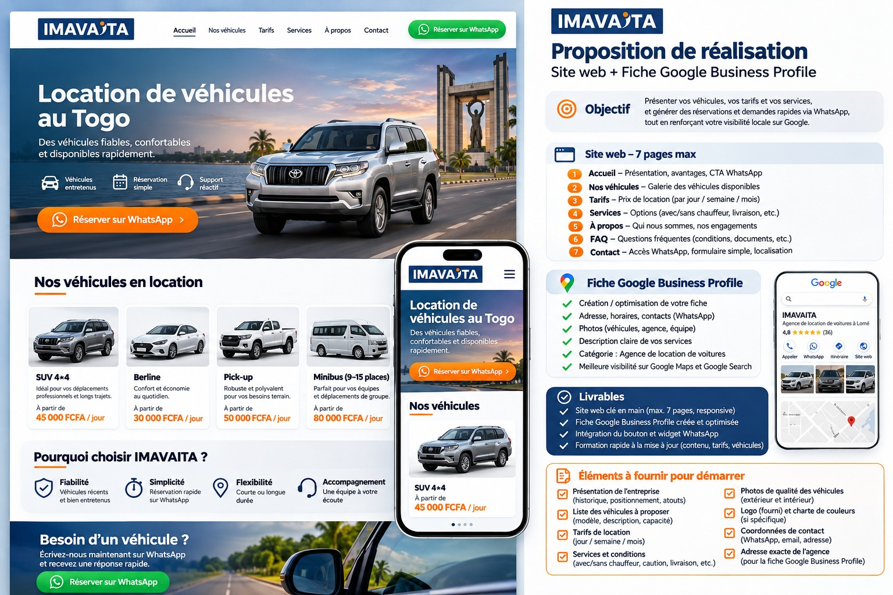
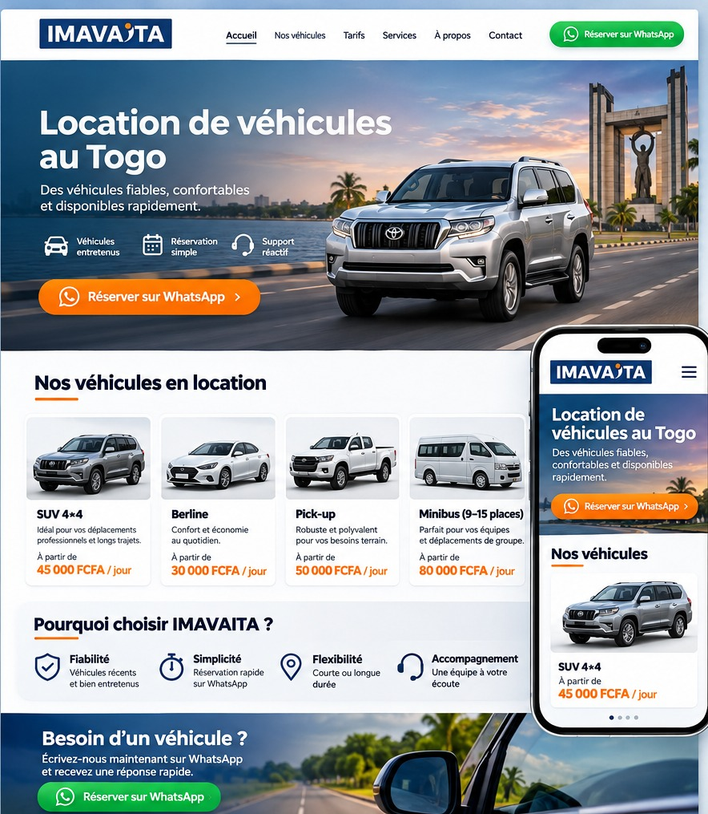
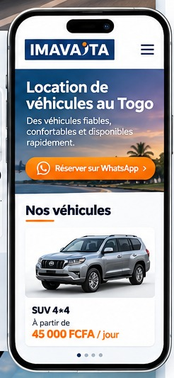
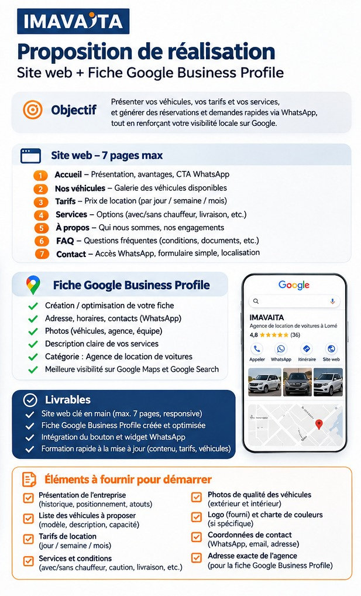

# IMAVAITA — Brief de création du site web

**Version :** 1.0 — 10 novembre 2026  
**Projet :** site vitrine commercial et catalogue de location de véhicules + fiche Google Business Profile  
**Statut :** cadrage initial, informations client à confirmer.

> **Principe central :** un site rapide, clair et rassurant, présentant un catalogue léger et administrable. Les demandes de réservation se font sur WhatsApp. Pas de paiement en ligne ni de moteur de réservation complexe.

## 1. Identité et références visuelles

**Nom :** IMAVAITA. **Activité envisagée :** location de véhicules au Togo, à confirmer avec le client.  
**Palette indicative issue du logo :** bleu marine, blanc, orange ; vert réservé principalement à WhatsApp.  
**Ton éditorial :** direct, rassurant, professionnel, orienté facilité de location.

### Maquette d'intention

**Important :** les voitures, prix, notes Google, contenus et avantages visibles dans les maquettes sont des **exemples fictifs de présentation**, et non des données vérifiées concernant IMAVAITA. Aucun tarif ou disponibilité ne doit être publié sans validation du client.

## 2. Objectifs et indicateurs

1. Faire comprendre l'offre en quelques secondes : type de véhicules, zones desservies et comment réserver.
2. Présenter proprement la flotte, les prix et les services.
3. Transformer la consultation d'une fiche véhicule en demande WhatsApp qualifiée.
4. Être facilement retrouvé via Google Search et Google Maps.
5. Permettre une mise à jour autonome du catalogue sans intervention technique.

**Indicateurs conseillés :** clics WhatsApp globaux, clics WhatsApp par véhicule, vues de fiches véhicules, appels et actions enregistrées sur la fiche Google lorsque disponibles.

## 3. Structure du site — 5 pages recommandées (7 maximum)

| Page | URL indicative | Contenu et action clé |
|---|---|---|
| Accueil | `/` | Promesse, photo forte, avantages, 3–4 véhicules à la une, témoignages réels s'il y en a, CTA WhatsApp |
| Nos véhicules | `/vehicules/` | Grille des véhicules publiés, catégories et filtres simples si utiles, accès aux détails et CTA |
| Tarifs et services | `/tarifs-services/` | Modalités de prix, avec/sans chauffeur, transferts, longue durée, caution, conditions à confirmer |
| À propos | `/a-propos/` | Présentation, identité, photos réelles, engagements vérifiés |
| Contact | `/contact/` | Bouton WhatsApp, téléphone, email, horaires, adresse, carte si pertinente |

**FAQ :** section réutilisable sur « Tarifs et services » ; pas forcément une page séparée.  
**Pages obligatoires additionnelles :** informations légales et confidentialité/cookies selon données collectées et réglementation applicable ; à prévoir dans le pied de page sans gonfler la navigation commerciale.

## 4. Parcours commercial

**Depuis l'accueil :** voir les véhicules → comparer → ouvrir une fiche ou cliquer « Réserver sur WhatsApp » → transmettre les détails → confirmation humaine.  
**Depuis Google Maps :** fiche Google → appel, itinéraire ou site → catalogue → WhatsApp.

### Réservation via WhatsApp

- Bouton fixe WhatsApp discret sur mobile et desktop ; ne pas masquer les cartes ou la navigation.
- Bouton spécifique dans chaque fiche véhicule.
- Message prérempli, par exemple : « Bonjour IMAVAITA, je souhaite connaître la disponibilité du [modèle] du [date] au [date]. Lieu de prise en charge : [lieu]. Avec chauffeur : [oui/non]. »
- Afficher le tarif indicatif **uniquement** si communiqué et approuvé. Ne pas promettre une disponibilité en temps réel.
- La confirmation, le paiement éventuel, la caution et les documents sont gérés par l'équipe IMAVAITA en dehors du site.

## 5. Catalogue administrable, sans surcharge

**Solution proposée :** WordPress et un type de contenu « Véhicules » avec champs personnalisés, sans WooCommerce ni réservation en ligne au lancement. La technologie définitive sera validée au démarrage.

### Champs d'une fiche véhicule

- Nom commercial, marque, modèle, catégorie ; capacité/passagers et transmission si utiles.
- 1 photo de couverture + jusqu'à 3 images secondaires optimisées.
- Prix par jour et, seulement si pertinent, par semaine/mois ; devise FCFA.
- Options : chauffeur, climatisation, type d'usage, livraison, autres caractéristiques confirmées.
- Statut interne : `brouillon`, `publié`, `masqué` ; badge facultatif `nouveau` ou `à la une`.
- Ordre d'affichage / catégorie.

### Mise à jour par IMAVAITA

1. Se connecter à l'interface d'administration.
2. Ouvrir « Véhicules » → « Ajouter » ou « Modifier ».
3. Importer les photos, saisir la description et les tarifs.
4. Vérifier le rendu → publier ou masquer.
5. Pour un nouvel arrivage, cocher « Nouveau » et, si nécessaire, « À la une ». **Aucune nouvelle page dédiée** aux arrivages.

### Règles anti-surcharge

- Accueil : **3 à 4 fiches maximum** + bouton « Voir tous nos véhicules ».
- Catalogue : cartes simples, images au même ratio, pagination ou bouton « Voir plus » si la flotte grandit.
- Pas de carrousel lourd, vidéos automatiques ou animations décoratives superflues.
- Photos chargées progressivement, formats WebP/AVIF selon compatibilité, tailles responsive.
- Compression à l'import ; poids indicatif à ajuster après test de performance.
- Une seule photo principale visible par carte, galerie complémentaire dans la fiche.
- Si le catalogue est très restreint, pas de filtres inutiles.

## 6. Design et contenu de l'accueil

1. **Barre haute :** logo, menu minimal, bouton WhatsApp.
2. **Bannière :** image réelle de bonne qualité ou visuel validé ; titre descriptif « Location de véhicules au Togo » (à approuver), texte court et bouton « Réserver sur WhatsApp ».
3. **Avantages :** 3 à 4 engagements factuels confirmés, jamais inventés.
4. **Véhicules à la une :** carte avec photo, nom, tarif s'il est connu, bouton « Voir / Réserver ».
5. **Services :** avec chauffeur, aéroport, longue durée uniquement si effectivement proposés.
6. **Réassurance :** avis réels et autorisés, modalités, processus en trois étapes.
7. **Bas de page :** coordonnées, horaires, lien Google Maps, mentions légales/confidentialité.

**Mobile first :** grandes zones tactiles, textes courts, WhatsApp visible sans gêner la lecture.

## 7. Fiche Google Business Profile

- Vérifier d'abord si une fiche existe, les accès et l'éligibilité de l'établissement.
- Créer ou revendiquer la fiche ; procéder à la validation demandée par Google avec le client.
- Ajouter le nom exact, catégorie adaptée, adresse/zone de service selon situation réelle, téléphone, horaires, site, description et photographies authentiques.
- Renseigner les services disponibles et l'URL du site.
- Paramétrer les options de contact proposées par Google **selon éligibilité et disponibilité** ; ne pas garantir un bouton WhatsApp natif.
- Prévoir une courte procédure de mise à jour et de réponse aux avis.

**Résultat visé :** cohérence site ↔ fiche Google ; aucune garantie de classement ou de volume de contacts.

## 8. Exigences fonctionnelles et techniques

- Site responsive, accessible sur connexions mobiles ; tests Android/iOS et tailles desktop.
- HTTPS, sauvegardes, comptes administrateurs distincts, mots de passe forts, mises à jour régulières.
- Titres SEO, métadescriptions, URLs lisibles, sitemap XML, indexation contrôlée, données structurées appropriées si possible.
- Optimisation des images, cache et limitation des plugins ; contrôles de performance avant livraison.
- Mesure des clics WhatsApp avec outil de statistiques seulement si validé, et respect des règles de confidentialité.
- Formulaire de contact facultatif : **WhatsApp en priorité** pour réduire la gestion et les données personnelles stockées.
- Domaine et hébergement : ownership et renouvellements au nom du client, coût à valider.
- Aucune gestion automatique de flotte disponible/non disponible en temps réel au lancement.

## 9. Livrables et recette

**Livrables :** site configuré, pages et catalogue alimentés, intégration WhatsApp, fiche Google créée/optimisée selon vérification, identifiants/transfert des accès, guide d'administration succinct, courte formation.

**Recette avant mise en ligne :** vérification du contenu et des prix, contrôle des liens WhatsApp depuis chaque voiture, test de navigation mobile, compression et affichage des photos, cohérence des coordonnées, contrôle SEO élémentaire, sauvegarde et tests des accès.

## 10. Informations à demander au client

### Entreprise
- [ ] Nom légal exact et nom commercial ; présentation / historique ; contacts et adresse.
- [ ] Numéro WhatsApp Business dédié ; email ; horaires ; localisation précise ; zones desservies.
- [ ] Logo dans sa meilleure définition, éventuellement version fond transparent ; photos de l'agence et de l'équipe (si souhaité).

### Flotte et tarifs
- [ ] Liste actuelle des véhicules : marque, modèle, année si utile, catégorie, places, équipements et services associés.
- [ ] Photos réelles de chaque véhicule (extérieur, intérieur), avec droit d'utilisation et noms de modèles.
- [ ] Tarifs par jour/semaine/mois ou mention « Sur devis » ; disponibilité des options avec/sans chauffeur.
- [ ] Caution, acompte de réservation, frais de livraison, kilométrage, carburant, assurance, taxes éventuelles et autres frais.
- [ ] Conditions de réservation, annulation, retrait, restitution et documents requis.
- [ ] Règles d'affichage souhaitées : catégories, nouveautés, véhicules mis en avant.

### Google et technique
- [ ] Existence d'une fiche Google et accès propriétaire/gestionnaire ; information pour validation si nécessaire.
- [ ] Domaine déjà acheté ? Hébergement ? Qui paie les renouvellements ?
- [ ] Responsable interne chargé de publier les arrivages et de répondre aux demandes WhatsApp.
- [ ] Autorisation de publication des photos, textes et éventuels avis clients.

## 11. Points à faire valider avant production

1. Inventaire réel et taille de la flotte ; s'agit-il de véhicules propres, partenaires ou mixte ?
2. Prix publics ou uniquement sur devis ?
3. Services réellement proposés et couverture géographique.
4. Numéro WhatsApp qui recevra les demandes ; modèle de message prérempli.
5. Domaine et hébergement ; budget et maintenance future.
6. Personne responsable des mises à jour et accès Google.
7. Textes juridiques et politique de confidentialité adaptés à l'activité.

## 12. Périmètre exclu de cette première version

Paiement en ligne, calendrier de disponibilités synchronisé, espace client, applications mobiles, gestion de stock/flotte avancée, automatisation WhatsApp, intégration CRM, multi-langue (sauf demande expresse). Toute extension fera l'objet d'un chiffrage distinct.

---

**Documents associés :** `Proposition_commerciale_IMAVAITA.docx` ; dossier `images/`.
